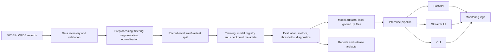

# Architecture

## System Diagram



## Module Responsibilities

| Module | Responsibility |
| :--- | :--- |
| `src/config` | Load and validate YAML config, resolve paths, apply environment overrides. |
| `src/data` | Load MIT-BIH records, validate complete WFDB triples, build split metadata. |
| `src/preprocessing` | Validate ECG inputs, filter signals, segment windows, normalize beats. |
| `src/models` | Build registered neural architectures. |
| `src/training` | Train models, apply class weighting/sampling, save checkpoint metadata. |
| `src/evaluation` | Evaluate models, tune thresholds, create metrics and diagnostics. |
| `src/inference` | Safely load checkpoints and return prediction payloads. |
| `src/api` | Serve `/health`, `/model-info`, `/predict`, and `/predict-file`. |
| `src/monitoring` | Log inference metadata and errors. |
| `scripts` | Expose runnable CLI workflows. |

## Artifact Flow

```text
datasets/mit-bih/                 local ignored input data
configs/default.yaml              source of pipeline settings
artifacts/models/*.pt             local ignored checkpoint files
artifacts/metrics/                training history and summaries
artifacts/evaluation/             split and threshold metadata
reports/evaluation/               human-readable model evaluation outputs
reports/experiments/high_budget/  capped research comparison outputs
docs/                             release and reproducibility documentation
```

## Config Flow

`configs/default.yaml` controls:

- Dataset source and MIT-BIH path.
- Sampling rate and preprocessing parameters.
- Class mapping and class order.
- Split ratios and record grouping.
- Model type and checkpoint path.
- Training hyperparameters.
- Inference thresholds and logging.
- Artifact/report output locations.

Environment variables can explicitly enable CI/demo fallbacks, but real MIT-BIH claims require local real data and real checkpoints.

## Model Promotion Logic

The default stable checkpoint is:

```text
artifacts/models/best_model.pt
```

Research candidates are written to:

```text
artifacts/models/candidates/
```

The high-budget experiment runner only copies a candidate to:

```text
artifacts/models/best_model_research.pt
```

when the promotion rule passes:

- Macro F1 improves over the baseline threshold.
- `A`, `L`, `R`, and `V` F1 are non-zero.
- Prediction distribution is not degenerate.
- At least four classes are predicted.

Promotion to the production baseline is intentionally manual and requires stronger evidence than this v0.2.0 research gate.
